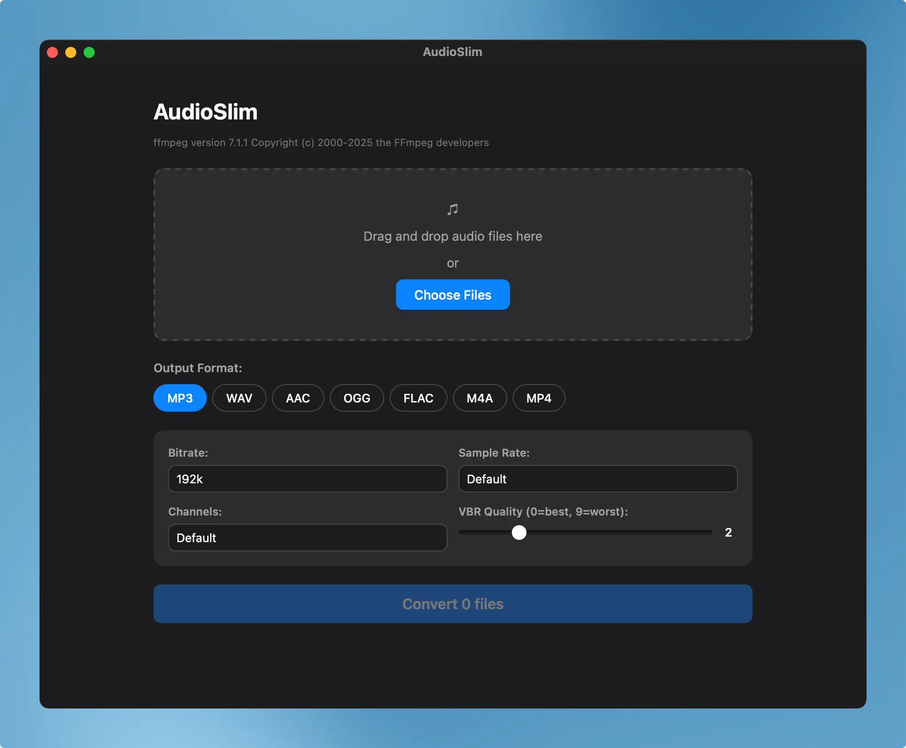

# AudioSlim

A desktop audio file converter and compressor. Convert audio files between formats with configurable compression options powered by FFmpeg.

Two implementations are available in this repository:

| Implementation | Stack | Directory |
|---|---|---|
| **Rust / Freya** (primary) | Rust · [Freya](https://github.com/marc2332/freya) · Tokio | `freya-app/` |
| Electrobun / React (legacy) | Bun · WKWebView · React · TypeScript | `src/` |

```bash
brew tap gianpaj/audioslim
brew install --cask audioslim
```



## Features

- Convert audio files between MP3, WAV, AAC, OGG, FLAC, M4A, and MP4 formats
- Configurable compression options: bitrate, sample rate, channels, and format-specific quality settings
- File picker for selecting multiple files
- Real-time conversion progress with before/after file size comparison
- Overwrite confirmation when output files already exist
- FFmpeg auto-detected (bundled or system install)

## Supported Formats

| Format | Bitrate | Quality | Notes |
|--------|---------|---------|-------|
| MP3    | 64k–320k | VBR 0–9 | Most compatible |
| WAV    | —       | —       | Uncompressed |
| AAC    | 64k–320k | —     | Good quality/size ratio |
| OGG    | 64k–320k | −1 to 10 | Open source format |
| FLAC   | —       | 0–8     | Lossless compression |
| M4A    | 64k–320k | —     | Apple ecosystem |
| MP4    | 64k–320k | —     | Audio-only MP4 container |

## Install

### Homebrew (macOS arm64)

```bash
brew tap gianpaj/audioslim
brew install --cask audioslim
```

### Manual

Download the latest `.dmg` from [Releases](https://github.com/gianpaj/audioslim/releases), open it, and drag AudioSlim to Applications.

> **Note:** The app is not code-signed. If macOS blocks it, run:
> ```bash
> xattr -cr /Applications/AudioSlim.app
> ```

---

## Rust / Freya app (`freya-app/`)

### Prerequisites

- [Rust](https://rustup.rs/) (stable toolchain)
- FFmpeg — bundled or installed via Homebrew:
  ```bash
  brew install ffmpeg
  ```

### Run (development)

```bash
cd freya-app
make run
# or: cargo run
```

### Build

```bash
cd freya-app

# Native release binary
make build

# macOS .app bundle (arm64 — Apple Silicon)
make bundle-macos-arm

# macOS .app bundle (Intel)
make bundle-macos-intel

# macOS universal binary
make build-macos-universal

# Linux x86_64  (requires `cross`: cargo install cross)
make build-linux-x86

# Linux arm64   (requires `cross`)
make build-linux-arm

# Windows x86_64 (requires `cross`)
make build-windows

# All platforms → freya-app/dist/
make build-all
```

Run `make help` inside `freya-app/` for the full target list. All binaries and the `.app` bundle are written to `freya-app/dist/`.

#### Cross-compilation setup

```bash
# Install all Rust targets at once
make add-targets

# Install cross (needed for Linux / Windows builds from macOS)
cargo install cross
# Docker must be running when using cross
```

### Tech Stack

- **GUI**: [Freya 0.3](https://github.com/marc2332/freya) (Skia renderer, Dioxus component model)
- **Async**: Tokio
- **File picker**: rfd
- **Audio processing**: FFmpeg (subprocess)

### Project Structure

```
freya-app/
├── src/
│   ├── main.rs        # All UI components and app state
│   ├── converter.rs   # FFmpeg discovery, arg building, conversion logic
│   └── types.rs       # Domain types, format configs, constants
├── Makefile           # Cross-platform build targets
└── Cargo.toml
```

---

## Electrobun / React app (legacy, `src/`)

### Prerequisites

- [Bun](https://bun.sh/)

### Setup

```bash
bun install
```

### Run

```bash
bun run start       # without HMR
bun run dev:hmr     # with HMR (recommended)
```

### Build

```bash
bun run build:stable:macos-arm64
```

The compiled application and DMG will be in `artifacts/`.

### Tech Stack

- **Runtime**: [Electrobun](https://electrobun.dev/) (Bun + WKWebView)
- **Frontend**: React 18 + TypeScript + Vite + Tailwind CSS
- **Audio Processing**: FFmpeg (bundled)

### Project Structure

```
├── src/
│   ├── bun/
│   │   ├── index.ts           # Main process
│   │   └── converter.ts       # FFmpeg audio conversion
│   ├── mainview/
│   │   ├── App.tsx            # React app component
│   │   ├── main.tsx           # React entry point
│   │   ├── index.html         # HTML template
│   │   └── components/        # UI components
│   └── shared/
│       ├── rpc.ts             # RPC type definitions
│       └── types.ts           # Shared types & format configs
├── scripts/
│   └── prepare-ffmpeg.ts      # Bundle FFmpeg into the app
├── icon.iconset/              # macOS app icons
├── electrobun.config.ts       # Electrobun configuration
├── vite.config.ts             # Vite configuration
├── tailwind.config.js         # Tailwind configuration
└── package.json
```

## Contributing

Contributions are welcome! Please feel free to submit a Pull Request.

## License

This project is open source and available under the [MIT License](LICENSE).
